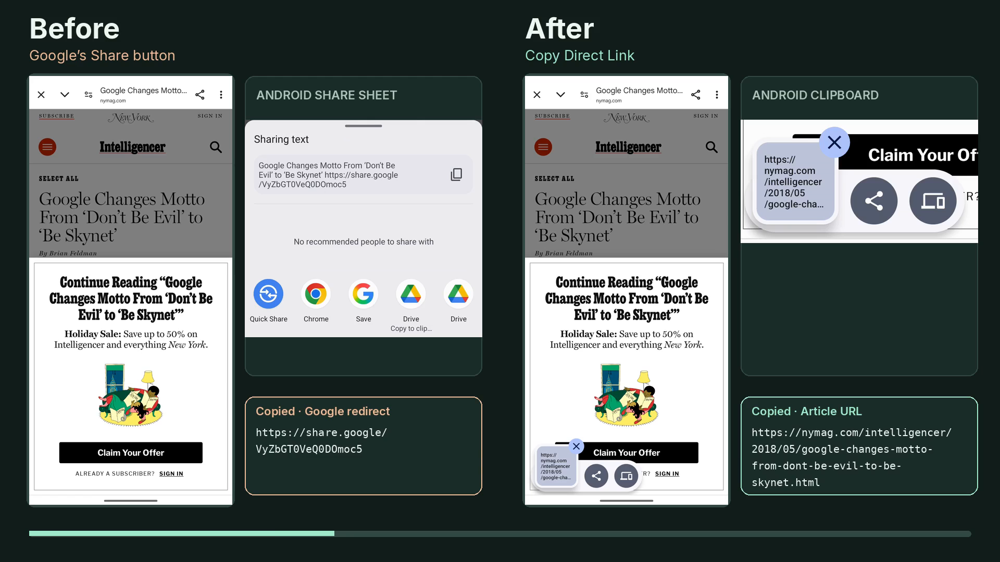

<p align="center">
  
</p>

<h1 align="center">Copy Direct Link</h1>

<p align="center">Tap Share in the Google app to copy the website’s real URL.</p>

<p align="center">
  <a href="https://github.com/AugusDogus/copy-direct-link/releases/latest">Download the APK</a>
  ·
  <a href="https://github.com/AugusDogus/copy-direct-link/actions/workflows/android.yml">GitHub Actions</a>
</p>

Open a search result in the Google app and the toolbar’s Share button can send you to a `share.google` link. Copy Direct Link makes that same tap copy the page address straight to your clipboard. Works on an unrooted Pixel 8 Pro.

## Demo

One article about Google’s old “Don’t be evil” motto, two ways to copy it. The stock Share sheet copies a `share.google` redirect. One tap with Copy Direct Link copies the article’s URL.

<p align="center">
  <a href="https://augusdogus.github.io/copy-direct-link/copy-direct-link-demo.mp4">
    
  </a>
  <br>
  <a href="https://augusdogus.github.io/copy-direct-link/copy-direct-link-demo.mp4">Watch the 10-second demo</a>
</p>

## Install

1. Download and install `copy-direct-link.apk` from [Releases](https://github.com/AugusDogus/copy-direct-link/releases/latest).
2. Open **Copy Direct Link**, tap **Open accessibility settings**, then select **Copy Direct Link** under **Downloaded apps** and turn on **Use Copy Direct Link**.
3. Open a web result in the Google app and tap the **Share** icon in the top toolbar. The URL is ready to paste.

If Android shows **Restricted setting**, open **Settings → Apps → Copy Direct Link → ⋮ → Allow restricted settings**, then return to Accessibility. With ADB connected, you can install the APK with `adb install copy-direct-link.apk`.

If you previously installed a debug build, uninstall it before installing the GitHub release, then enable the service again. Android requires the same signing key for an in-place update.

## How it works

The accessibility service finds Google’s Share icon in a Chrome Custom Tab and places a transparent button over it. A tap invokes Chrome’s built-in long press on the page title. Chrome copies the full URL and keeps the page open.

The app has no network permission. It listens for window changes to place or remove the button and uses Chrome to write the URL to the clipboard. To restore the usual Share behavior, turn the service off in Accessibility or uninstall Copy Direct Link.

Tested on a Pixel 8 Pro running Android 17 and an Android 16 emulator with Chrome `157.0.8103.78`. The app installs on Android 11 and later. It depends on the Google app opening results in Chrome Custom Tabs.

## Build from source

Use JDK 17 or later, Android SDK Platform 36, and Build Tools 36.0.0. Point `ANDROID_HOME` or `ANDROID_SDK_ROOT` at your SDK.

```sh
git clone https://github.com/AugusDogus/copy-direct-link.git
cd copy-direct-link
./build.sh
```

The script writes `dist/copy-direct-link.apk` and signs local builds with your Android debug key. GitHub Actions builds a debug artifact for pull requests and pushes to `main`. Pushing a `v*` tag builds a signed APK and publishes it to GitHub Releases.
