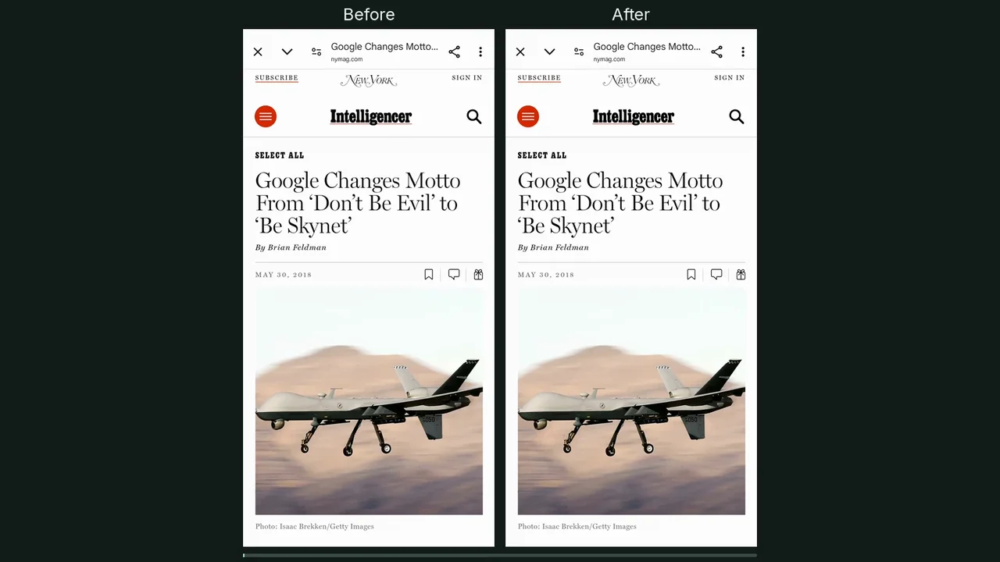

  
  <h1>Copy Direct Link</h1>
  
Tap Share in the Google app to share the page’s real URL. Android 11 and later, no root required.

  
<a href="https://github.com/AugusDogus/copy-direct-link/releases/latest">Download APK</a> · <a href="#use-it">Get started</a> · <a href="https://augusdogus.github.io/copy-direct-link/copy-direct-link-demo.mp4?v=4">Play demo</a>

  <a href="https://augusdogus.github.io/copy-direct-link/copy-direct-link-demo.mp4?v=4">
    <picture>
      <source media="(prefers-reduced-motion: reduce)" srcset="docs/demo.png">
      
    </picture>
  </a>

The same tap opens Android’s share sheet on both sides. Google shares a `share.google` redirect. Copy Direct Link shares the full article URL. [New York Magazine article](https://nymag.com/intelligencer/2018/05/google-changes-motto-from-dont-be-evil-to-be-skynet.html)

## Use it

1. **Install.** Download `copy-direct-link.apk` from [Releases](https://github.com/AugusDogus/copy-direct-link/releases/latest) and open it on your phone.
2. **Enable it.** Open **Copy Direct Link**, tap **Open accessibility settings**, then select **Copy Direct Link** under **Downloaded apps**. Turn on **Use Copy Direct Link** and tap **Allow**.
3. **Share a page link.** Open a search result in the Google app and tap **Share** in the page’s top toolbar. Android’s share sheet opens with the full page URL.

**Share link** is the default. To copy the address in one tap, choose **Copy link** under **When you tap Share** in the app.

If Android shows **Restricted setting**, open **Settings → Apps → Copy Direct Link → ⋮ → Allow restricted settings**, then return to Accessibility. If you installed a debug build earlier, uninstall it before switching to the signed release and enable the service again.

## Compatibility

Copy Direct Link works when the Google app opens a result in a Chrome Custom Tab. The copy action was tested on an unrooted Pixel 8 Pro running Android 17 and on an Android 16 emulator. Both toolbar modes were tested on Android 16.

How it works

Copy Direct Link’s accessibility service finds the Share button in the Custom Tab toolbar and places a transparent button over it. In Share link mode, the app briefly opens Chrome’s site info to read the full address, then sends it to Android’s share sheet. Copy link uses Chrome’s built-in copy action, the same one you get by holding the page title.

The app has no network permission. Turn off its accessibility service to restore the original Share button behavior.

## Build

With JDK 17 or later, Android SDK Platform 36, and Build Tools 36.0.0 installed, set `ANDROID_HOME` or `ANDROID_SDK_ROOT` and run `./build.sh`. The debug-signed APK is at `dist/copy-direct-link.apk`.

GitHub Actions builds development APKs for pull requests and pushes to `main`. Pushing a version tag publishes a signed release APK. [Build workflow](https://github.com/AugusDogus/copy-direct-link/actions/workflows/android.yml)
